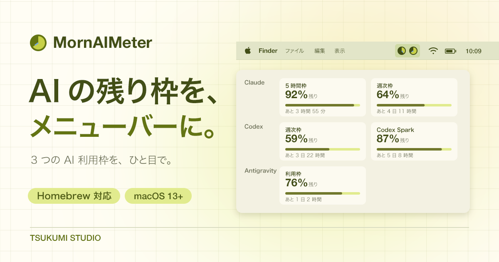
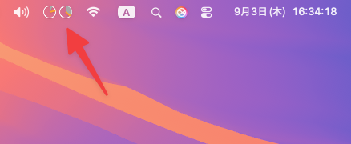
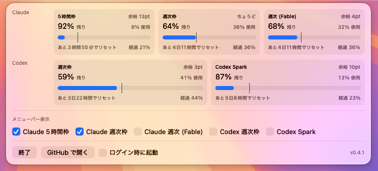

# MornAIMeter

Claude Code / Codex CLI / Antigravity / GitHub Copilot CLI の利用枠 (usage) をメニューバーの円グラフで見る、Mac
ローカル完結の常駐アプリです。




## Homebrew での導入

```bash
brew install --cask tsukumistudio/tap/mornaimeter
```

## Homebrew での更新

```bash
brew update
brew upgrade --cask mornaimeter
```

更新後はアプリを一度終了して起動し直してください。

## Homebrew でのアンインストール

```bash
brew uninstall --cask mornaimeter
```

## 前提

- Claude Code (`claude login`)、Codex CLI (`codex login`)、Antigravity CLI (`agy` で一度
  ログイン) にログイン済みであること。使っていないものは未ログインでも構いません
  (その枠だけ表示されません)。
- このアプリは各 CLI がログイン時に保存したトークンを読み、Anthropic / OpenAI / Google の
  公式 usage API に残り枠を問い合わせています。
- 初回起動時に macOS がアクセス許可ダイアログを 1 回表示します。「常に許可」を選ぶと
  以後は表示されません。
- Copilot CLI は `copilot login` の認証情報を読み、月次のプレミアムリクエスト枠を表示します。GitHub の内部 API を使用するため、プランや API の変更により表示できない場合があります。
- Antigravity のトークンが切れているときは、アプリが裏で `agy` を数秒だけ起動して更新
  します (ターミナルは開きません)。

## 開発

```bash
bash build-app.sh          # build/MornAIMeter.app を生成
swift build -c release
swift test
```
